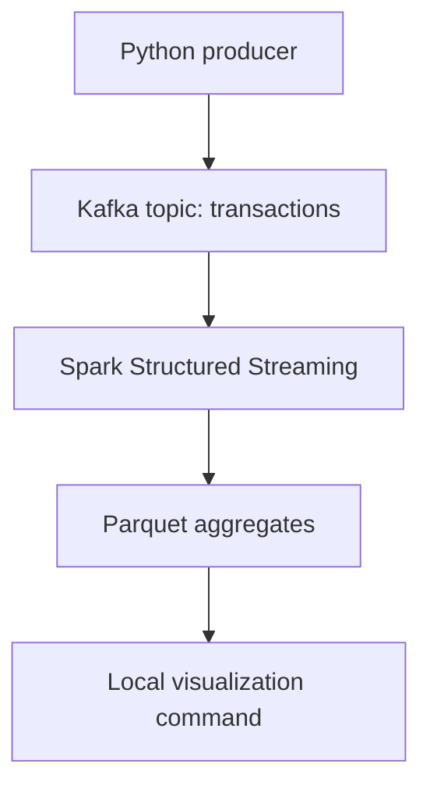

# Real-Time Fraud Detection Pipeline

A local, containerized data-engineering prototype that publishes simulated transaction events to Kafka, processes them with Spark Structured Streaming, and writes closed one-minute aggregates to Parquet. It was created for a data-engineering course and is maintained here as a reproducible portfolio project.

## What it demonstrates

- Kafka event ingestion with key-based partitioning and delivery acknowledgements
- Spark Structured Streaming with schema validation, event-time watermarks, and bounded-state deduplication
- One-minute per-user aggregates and a transparent rule-based suspicious-window indicator
- Docker Compose infrastructure for Kafka, Spark, and an optional producer service
- A separate visualization command for Parquet aggregates
- Automated checks for the producer data contract and Docker Compose configuration

## Implemented architecture



See [the architecture notes](docs/architecture.md) for data contracts and operational boundaries.

## Quick start

Prerequisites: Docker Desktop (with Docker Compose v2) and at least 4 GB of memory available to Docker.

```bash
docker compose up --build -d
docker compose --profile producer run --rm producer --num-records 10000 --rate 1000
docker compose logs -f spark
```

The producer is intentionally an opt-in Compose profile: it gives a reviewer control over when data is sent. Spark reads from the beginning of the local topic on a fresh checkpoint. Because the Parquet sink emits **closed, watermarked windows**, keep the stream running briefly after sending events before inspecting `output/`.

To stop and remove local containers:

```bash
docker compose down
```

Runtime state (`output/`, `checkpoint/`, and dependency caches) is deliberately ignored by Git. Remove those local directories before a completely fresh run.

## Optional seed data

The producer creates synthetic events by default. It can optionally derive amount and label proportions from a local CSV containing an `Amount` column and an optional `Class` column; the dataset is not included in this repository.

```bash
docker compose --profile producer run --rm \
  -v "$(pwd)/local-data:/data:ro" producer \
  --bootstrap-server kafka:29092 \
  --input-file /data/creditcard.csv \
  --num-records 100000
```

Each run assigns monotonically increasing transaction IDs beginning at the current epoch in nanoseconds, avoiding the collisions present in random-ID demos. Use `--start-id` when a specific range is needed.

## Visualize the results

Install the optional visualization dependencies locally, then render the Parquet aggregate output:

```bash
python -m pip install -r visualization/requirements.txt
python visualization/visualize.py --input output --output artifacts/stream_summary.png
```

The generated chart is local evidence, not a committed project artifact.

## Tests and static checks

```bash
python -m pip install -r requirements-dev.txt
python -m compileall producer spark visualization
python -m pytest
```

GitHub Actions runs these checks on Python 3.11 and 3.12 for every push and pull request.

## Scope and limitations

This is an educational, single-node prototype, not a production fraud-detection system. The rule marks an aggregate as suspicious when either its total amount exceeds 1,000 or its transaction count exceeds 5; it is not a predictive model. Kafka runs with a replication factor of 1 because the Compose stack has one broker, and all traffic uses local plaintext listeners. Production deployment would require multi-broker replication, authentication/encryption, secret management, durable monitoring, access controls, and an evaluated detection model.

No raw transaction data, personal data, course reports, or generated runtime outputs are committed.
